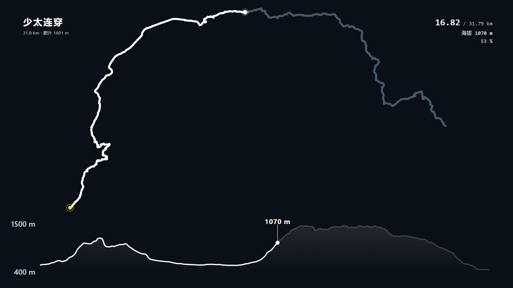

# 轨迹生长 + 海拔剖面动画（Remotion）

把一条 GPS 轨迹（KML / GPX）做成「轨迹沿真实路径生长、海拔剖面同步推进、游标联动」的动画，默认输出**透明底**视频，直接丢进剪映/PR 叠加。



> 上图是 `npm run demo` 解析真实轨迹「少太连穿」（嵩山少室山—太室山连穿，31.8 km · 爬升 1801 m）的实拍帧，深色底只是为了让白线看得清；实际输出是透明底。

附一个**浏览器调参台**：拖滑块改样式、拖动加点改途经点、实时预览，点一下写回配置。

```
轨迹从起点生长 → 走过的部分高亮 → 头部圆点 + 里程/海拔读数
下方海拔剖面整条显示，游标与地图头部严格同步
底色 alpha=0，白线任意叠在深色画面上
```

---

## 一、三步上手（约 5 分钟）

前置：**Node 18+**（推荐 22）。

```bash
# 下载仓库（Download ZIP 也行）
git clone https://github.com/YangPhYY/remotion-trail-profile.git
cd remotion-trail-profile/project

# ① 装依赖（Remotion 本体，实测 2~3 分钟 / 192 个包）
npm install

# ② 解析示例轨迹（嵩山「少太连穿」31.8 km）→ src/trail-profile-data.json
npm run demo

#    想用自己的轨迹：把 KML 放到任意位置，然后
#    npm run build-track -- "路径/你的轨迹.kml" --step=10

# ③ 打开调参台看效果
npm run studio-trail        # → http://localhost:5232/trail-studio.html
```

调参台打开后就能看到这条连穿轨迹、海拔剖面和实时预览。改完参数点右上角「保存到文件」，写回 `src/trail-profile-defaults.json`。

出片：

```bash
npm run still-trail          # 先渲一张静帧确认效果（几秒，别直接出整片）
npm run render-trail-alpha   # → out/trail-profile-alpha.mov（ProRes 4444，带 alpha）
npm run render-trail         # → out/trail-profile.mp4（预览用；mp4 不存 alpha，透明区会变黑底）
```

> **首次出片会自动下载 Chrome Headless Shell（约 102 MB）**，实测 1~3 分钟，网慢时更久，期间看起来像卡住；它装在 `node_modules/.remotion/` 里，删掉 `node_modules` 就要重下。想直接跳过，把本机已有的浏览器指过去：
>
> ```bash
> npm run render-trail-alpha -- --browser-executable "C:/Program Files (x86)/Microsoft/Edge/Application/msedge.exe"
> ```
>
> **耗时参考**（1920×1080 / 1395 帧 / 本机实测）：默认**光晕关闭**约 **40 分钟**（1.6 秒/帧）；打开「轨迹 › 显示光晕」约 **2.5 小时**（6.4 秒/帧，慢 4 倍）。想更快就调小「动画节奏 › 时长秒」，或加 `--concurrency=4`。

> 出片读的是 `src/trail-profile-defaults.json`（示例里「透明背景」已开）。想临时改参数又不想动 defaults，就把它复制成 `out/my-props.json`，再在命令后加 `--props=out/my-props.json`。注意 `--props` 是**浅合并**：只传一个子组，其余子组会被整组替换，所以必须传完整 defaults。

> 只需要调参台、不想出片时，**不用 `npm install`** —— 调参台只依赖 Node 内置模块和三个本地 `.mjs`，零第三方包。

---

## 二、换成你自己的轨迹

```bash
# KML 或 GPX 都行
node scripts/build-trail-profile.mjs "/你的/路径/轨迹.kml" --step=10
```

输出会告诉你点数、里程、海拔区间、爬升和坐标系判定（WGS-84 会自动转 GCJ-02）。

| 参数 | 说明 |
|---|---|
| `--step=10` | 等里程重采样间隔（米）。10 m 适合 5~30 km 的线路，太长改 20，太短改 5 |
| `--no-verify` | 跳过坐标系校验。没有高德 key、或坐标是虚构示例时用 |
| `--out=xxx.json` | 自定义输出路径，默认 `src/trail-profile-data.json` |

数据落到 `src/trail-profile-data.json` 后，调参台和渲染会自动读新的。

---

## 三、申请高德 Key（可选，但建议申请）

**不申请也能跑**。Key 只用于两件事：自动判断你的轨迹是 WGS-84 还是 GCJ-02、以及在浏览器里加载高德地图底图。没有 key 时轨迹动画、海拔剖面、调参台、出片全部正常。

### 3.1 先注册账号

1. 打开 <https://console.amap.com/dev/id>，注册并登录
2. 完成**个人开发者**实名认证（免费，需身份证）
3. 进入控制台 → **应用管理 → 我的应用**

### 3.2 创建 key（这里最容易搞错：三种 key 不通用）

同一个应用下可以添加多个 Key，**「服务平台」必须选对**，选错了调接口会报 `INVALID_USER_KEY`。

| 你要填的变量 | 服务平台要选 | 用在哪 | 不填会怎样 |
|---|---|---|---|
| `AMAP_SERVER_KEY` | **Web 服务** | 坐标转换、地理编码、路径规划 | 跳过坐标系校验，按 WGS-84 处理（国内轨迹会有几十~一百多米的偏移） |
| `AMAP_WEB_JS_KEY` | **Web 端(JS API)** | 浏览器里显示高德地图 | 只影响可选的 3D 查看器，不影响本仓库主流程 |
| `AMAP_WEB_SECURITY_CODE` | JS API key 配套的**安全密钥** | 同上 | 同上 |

操作步骤：

1. **我的应用 → 创建新应用**（名称随便填，类型选「出行」或「其他」）
2. 在新应用里点 **添加 Key**
   - 要 `AMAP_SERVER_KEY` → 「服务平台」选 **Web服务**，提交即可
   - 要 `AMAP_WEB_JS_KEY` → 「服务平台」选 **Web端(JS API)**，按提示填域名白名单（本地开发填 `localhost` 或留空）
3. 列表里的 Key 列就是 key 值；JS API 那一行右侧还有「安全密钥」列，点开可以查看/生成
   - **2021-12-02 之后申请的 key 必须同时配安全密钥**，否则报 `INVALID_USER_SCODE`
4. 免费额度见控制台「配额管理」，个人开发者日常够用；超了会返回 `OVER_QUOTA`

官方文档：
- Web 服务 key：<https://lbs.amap.com/api/webservice/guide/create-project/get-key>
- JS API 安全密钥：<https://lbs.amap.com/api/javascript-api-v2/guide/abc/prepare>

### 3.3 填进本地配置

```bash
cd project
cp .env.example .env       # Windows: copy .env.example .env
# 用编辑器打开 .env，把值填在等号右边，不要加引号
```

```ini
AMAP_SERVER_KEY=你的32位key
AMAP_WEB_JS_KEY=
AMAP_WEB_SECURITY_CODE=
```

> `.env` 已被 `.gitignore` 忽略。**不要把 key 写进 `SKILL.md`、代码或截图里**。

---

## 四、把「技能」装进 AI 助手

`skills/remotion-trail-profile/` 是一份给 AI 助手看的操作手册（`SKILL.md`），里面写的是**决策规则和坑**，不是流水账：产品形态怎么选、相机铁律、剖面为什么整条显示、途经点坐标怎么换算、哪些操作会让渲染慢 3 倍、透明片怎么验。

装法（放对应目录即可，下次对话生效）：

| 助手 | 目标路径 |
|---|---|
| WorkBuddy | `~/.workbuddy/skills/remotion-trail-profile/`（Windows: `C:\Users\<你>\.workbuddy\skills\`） |
| Claude Code | `~/.claude/skills/remotion-trail-profile/` |

```bash
mkdir -p ~/.workbuddy/skills
cp -r skills/remotion-trail-profile ~/.workbuddy/skills/
```

装好后说一句「用这条 KML 做轨迹动画」，助手就会按手册的流程走。

---

## 五、目录结构

```
.
├── README.md
├── .gitignore                     # .env / out / node_modules / 生成的 html 一律不入库
├── scripts/check-secrets.mjs      # 提交前自检：仓库里有没有混入 key
├── skills/remotion-trail-profile/
│   ├── SKILL.md                   # 操作手册（决策规则 + 坑）
│   └── references/
│       └── satellite-overlay.md   # 卫星截图叠轨迹的做法（进阶）
└── project/                       # 最小可跑工程
    ├── .env.example               # 三种高德 key 的模板
    ├── package.json
    ├── tsconfig.json
    ├── trail-studio.html          # 调参台（单文件，ES module）
    ├── examples/
    │   ├── shaotai-lianchuan.kml  # 真实示例：嵩山少太连穿（31.8 km）
    │   ├── make-demo-kml.mjs      # 生成虚构轨迹（npm run demo:synthetic）
    │   └── demo-loop.kml          # 虚构环线（7.2 km，不含任何真实坐标）
    ├── scripts/
    │   ├── build-trail-profile.mjs    # KML/GPX → 等里程重采样 → data.json
    │   └── trail-studio-server.mjs    # 调参台本地服务（5232）
    └── src/
        ├── TrailProfile.tsx           # Remotion 合成组件
        ├── trail-scene.mjs            # ★ 场景模型：唯一的几何真相源
        ├── trail-geo.mjs              # 墨卡托 / 重采样 / 缓动
        ├── trail-params.mjs           # 参数表（调参台与 schema 共用）
        ├── trail-profile-schema.ts    # zod 校验
        ├── trail-profile-defaults.json
        └── schema.ts / index.tsx / Root.tsx
```

核心设计：**几何只有一份**。`trail-scene.mjs` 是纯函数，Remotion 组件和调参台调的是同一个 `buildTrailScene()` —— 所以调参台里看到的就是最终成片，不存在「面板和视频不一致」。

---

## 六、常见问题

| 现象 | 原因 | 处理 |
|---|---|---|
| `Could not find composition` / 合成列表为空 | 打包报错，或入口文件不对 | 先跑 `npx remotion compositions src/index.tsx` 看完整报错 |
| 渲染报找不到浏览器 | Remotion 自带的 `chrome-headless-shell` 缺失（升级后常见） | 加 `--browser-executable "<你的 Chrome/Edge 路径>"`，或 `npx remotion browser ensure` |
| 调参台一片空白 / 面板不出现 | 浏览器 `import` 的模块里混进了 `node:` 依赖 | 三个 `trail-*.mjs` 必须保持纯浏览器可执行，不要加 `node:fs` 之类 |
| 轨迹整体偏移几十米 | 坐标系没纠偏 | 配 `AMAP_SERVER_KEY` 后重跑 `build-trail-profile`，别加 `--no-verify` |
| 渲染慢到不可用 | 开了「轨迹光晕」 | 关掉 `轨迹.显示光晕`（实测占约 2/3 渲染时间） |
| 透明片看着不透明 | 用错解码器 | `.webm` 抽帧必须指定 `-c:v libvpx-vp9`，否则 alpha 会被忽略 |
| 换轨迹后标题还是上一条 | 主标题是独立参数 | 调参台「文字标题 → 主标题」里改 |

更多细则在 `skills/remotion-trail-profile/SKILL.md`。

---

## 七、合规与免责

- 本仓库**不含任何地图瓦片或底图截图**。
- 示例轨迹 `examples/shaotai-lianchuan.kml` 取自「两步路」公开轨迹（上传者 **破浪绍兴**，2025-05-30），仅作功能演示，版权归原作者；原作者若不愿被引用，提 issue 即可删除。
- `examples/demo-loop.kml` 是脚本生成的**虚构坐标**，不对应任何真实地点。
- 高德地图服务受[高德开放平台服务条款](https://lbs.amap.com/home/terms)约束。key 配额、调用量、底图数据的使用与分发限制由你自己承担；**不要把抓取到的瓦片或拼接底图提交到本仓库或任何公开位置**。
- 用**自己的**轨迹发公开仓库前先评估：轨迹起点/终点往往就是你的住址或停车点。
- 提交前请跑 `node scripts/check-secrets.mjs`。可以挂成 git 钩子：

```bash
echo 'node scripts/check-secrets.mjs || exit 1' > .git/hooks/pre-commit
chmod +x .git/hooks/pre-commit
```

---

## License

MIT
